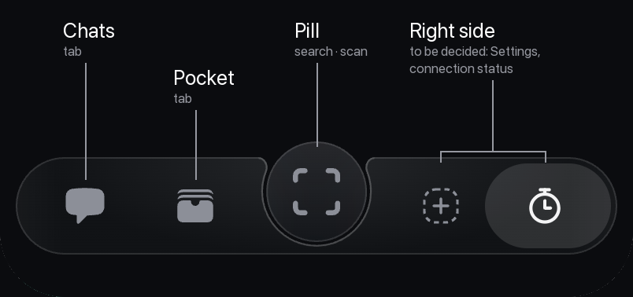
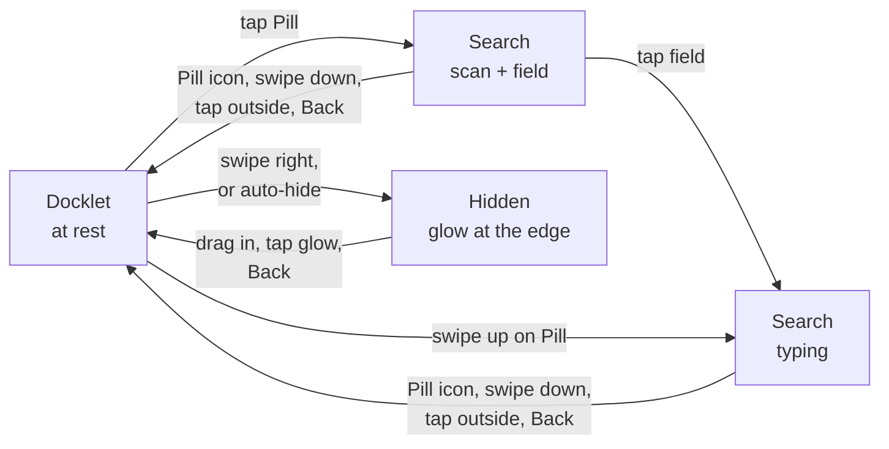
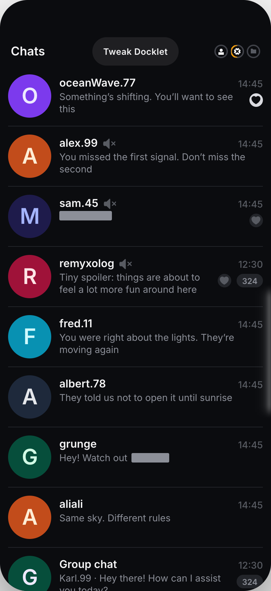
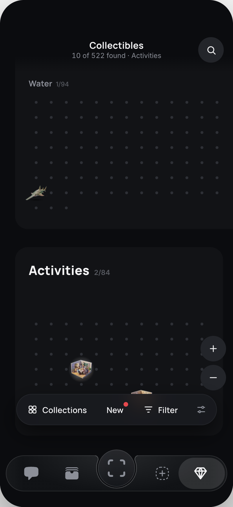
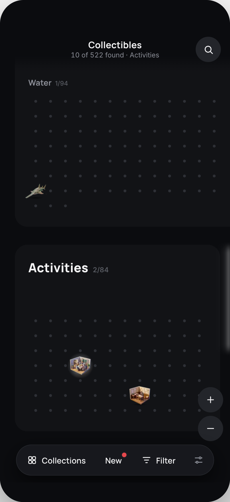
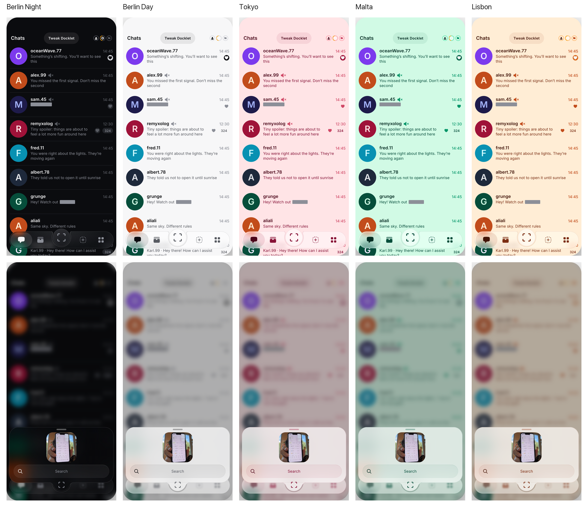

# Docklet R2 brief

> **A living document.** The Docklet goes through periodic reviews, and this page is updated and extended after each of them.

R2 is the Docklet of R1, the bar with search from the Pill, plus two things: **the Docklet can be hidden**, and **a product's own controls at the bottom of the screen ride above the Docklet**. The expanded view with every product, the pin slot, the app switcher and the Browse tab are not in R2; they are in the [R3 brief](https://github.com/SabitKadyr/docklet-playground-src/blob/main/docs/docklet-r3/Docklet%20R3%20brief.md). Sizes, colours, fonts and motion for developers are in the R1 brief.

The screenshots come from the prototype (Docklet Liquid v0.2.24, [APK](https://github.com/SabitKadyr/docklet-playground-src/releases)) and its Collectibles fork. The prototype's dock still shows R3 slots on the right; in R2 that side is still to be decided.

## Scope

| In R2 | Not in R2 (R3) |
| --- | --- |
| The Docklet bar: Chats, Pocket, the Pill, the right side | The expanded view with every product (swipe up on the Docklet) |
| Search from the Pill, both steps (R1) | The pin slot |
| Hiding the Docklet: the swipe away, the edge glow, bringing it back, auto-hide | The right slot as an app switcher (hotseat), the product menu |
| A product's bottom controls riding above the Docklet | The Browse tab and third-party products |
| Themes and glass (R1) | |

## What's on it

| Part | What it is | Tap |
| --- | --- | --- |
| **Chats**, **Pocket** | The app's two main tabs | Goes there |
| **Pill** (centre) | Search and scan | Opens search |
| **Right side** | To be decided: Settings, a connection status indicator, or both | — |

A highlight sits on the tab you are in.

## Gestures at a glance

| Where | Gesture | Result |
| --- | --- | --- |
| Pill | Tap | Search opens: scan and a search field |
| Pill | Swipe up | Search opens straight to typing |
| Docklet | Swipe right | The Docklet hides into the right edge |
| Right edge, Docklet hidden | Drag in, tap the glow, or Back | The Docklet comes back |
| Anywhere outside the Docklet | Tap | The Docklet hides on its own |

A swipe up on the Docklet itself (outside the Pill) does nothing in R2: there is no expanded view to open.

## Search from the Pill

As in R1.

<table><tr>
<td> At rest: the Pill shows the scan icon</td>
<td> Tap: scan preview and search field</td>
<td> Field or swipe up: typing</td>
</tr></table>

- **One shape.** The search card grows out of the Pill as one piece of glass; the Pill becomes the bump at the card's bottom.
- **Two steps.** A tap opens the camera to scan and a search field. A tap on the field moves on to typing, with recent contacts above the keyboard. A swipe up on the Pill skips straight to typing.
- **The scan icon stays.** It never turns into a ✕: it shrinks and rides down into the bump, where a tap on it closes the card.
- **Closing:** the icon in the bump, a swipe down on the card, a tap outside it, or Back.

## Hiding the Docklet

New in R2.

### Drawbridge: swipe it away

<table><tr>
<td> Swipe right: the Docklet follows the finger</td>
<td> Hidden: a faint glow at the right edge</td>
<td> Drag it back in from the glow</td>
</tr></table>

- **Swipe right** anywhere on the Docklet and it swings up and out into the right edge, like a drawbridge. The closer to the edge you start, the shorter the swipe needed.
- **It stays under your finger**, also if you swipe right and then down, and runs a little ahead towards the edge so you feel where it is going.
- **It can't be dragged all over the screen.** The bottom of the screen is a floor. Lifted, it follows the finger up to the top of the edge glow, and only past that meets a resistance that grows the further you go; pulled away from the edge, it resists from the start. Letting go up there settles it back: only the swipe to the right hides it.
- **Let go** past halfway, or with a quick flick, and it hides; otherwise it settles back.
- **Hidden**, a soft glow marks the edge. It brightens and shimmers when you touch it.
- **Bringing it back:** drag it in from the glow, tap the glow, or swipe Back from that edge below the glow. Dragged out, it turns about its pivot at the edge to point at your finger: low and far from the edge it is fully out, high at the edge fully in, so a swipe a third of the way in and then down brings it out fully. On a tab, the Back key brings it back too; inside a product, Back belongs to the product (see Open questions). A Back swipe from the other edge is a plain Back and leaves it hidden.
- On Android, the system Back gesture is off where the Docklet is (and over the glow while it is hidden), so these swipes reach the Docklet.

### Auto-hide

 The first time it hides on its own, it says so

- The Docklet hides as soon as you tap outside it, and after **3 seconds** without a touch.
- It stays while something on it is open: search or a tip.
- The first time it hides on its own, a tip says "Your dock is tucked away" and how to get it back.

## Products and their controls

New in R2.

> **Collectibles here is a placeholder.** It is a copy of a demo, used only to test how the Docklet works with a product that has controls at the bottom. Ignore what it does and how it looks.

### Opening a product

In R2 the Docklet has no way into products: no expanded view, no app switcher. A product opens from its own entry point in the app, for example from a chat. The Docklet stays at the bottom over the product and works as anywhere else: search, hiding and auto-hide.

### A product's bottom controls ride above the Docklet

<table><tr>
<td> Docklet shown: the product's bar sits just above it</td>
<td> Docklet hidden: the bar is back in its own place</td>
</tr></table>

- **While the Docklet is shown**, everything the product keeps at the bottom of the screen moves up above it, with a small gap: its own bar, the hints and buttons floating over that bar, and any sheet it has open (in Collectibles: the Collections and Filter sheets, the Send button on a piece's card). In the prototype the lift is 51 pt, which leaves 8 pt between the product's bar and the Docklet.
- **When the Docklet hides**, they come back down to their own place; when it returns, they go back up. The motion follows the Docklet frame by frame: it moves with the finger during a swipe and settles with the Docklet's own spring.
- **Closed sheets stay where they are.** A product usually parks a closed sheet below the bottom edge; it must not be lifted with the rest, or its top would peek out above the Docklet.
- **Touches on the Docklet count as activity in the product**, so the product's own idle hints don't pop up while you use the Docklet.

## Look: themes and glass

As in R1.

- **The app's five themes:** Berlin Night (the default), Berlin Day, Tokyo, Malta and Lisbon. Every colour of the Docklet comes from the app's design tokens, so a theme changes only their values. A theme switch applies at once.
- **One outline** runs round the Docklet, the Pill and the search card: on the light themes slightly darker than the glass, in the theme's own hue. There is no shadow.
- **Glass:** iOS 26 and later use the system Liquid Glass; below iOS 26 and on Android the glass is the theme's surface colour over a blur.

## Open questions

- **The right side of the Docklet.** Settings, a connection status indicator, or both; what each shows and does.
- **How a product learns where the Docklet is.** The fork reaches into the product's page directly, which only works for a same-origin prototype. A real product needs a contract from the app: the Docklet's height and whether it is shown, live during the hide motion, and which of its elements to lift.
- **Which tab is highlighted while a product is open**, when the product was opened from a chat.
- **Back inside a product.** In the prototype, Back in a product leaves the product rather than bringing the hidden Docklet back. With real products that have their own back navigation, the order needs deciding: product first, Docklet first, or the Docklet only when the product has nothing left to go back to. Related: while the Docklet is shown, Android's Back gesture is off across the bottom 200 dp, so a product cannot use edge swipes there.
- **Auto-hide inside a product.** Whether the Docklet should hide on its own as soon as a product opens, to give it the whole screen.
