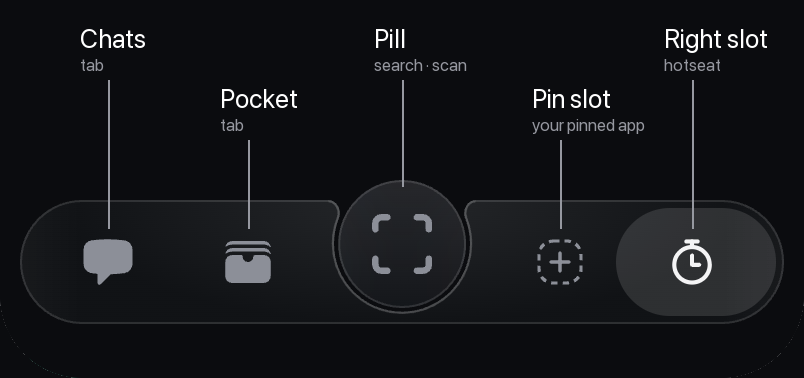
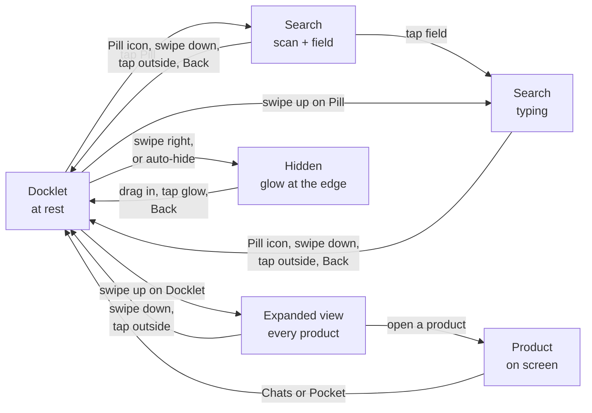
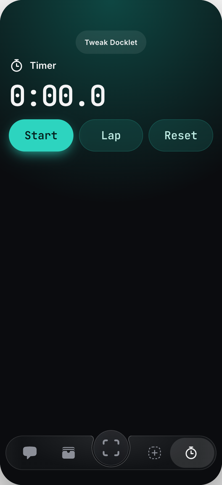
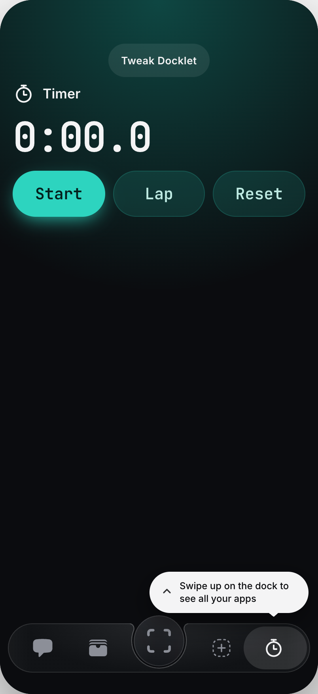
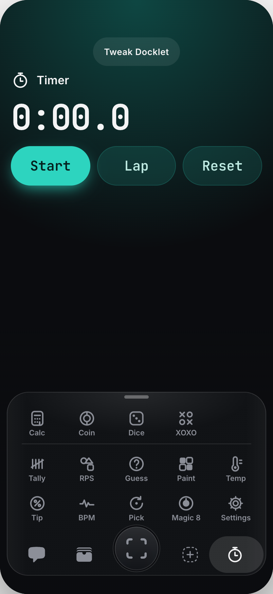
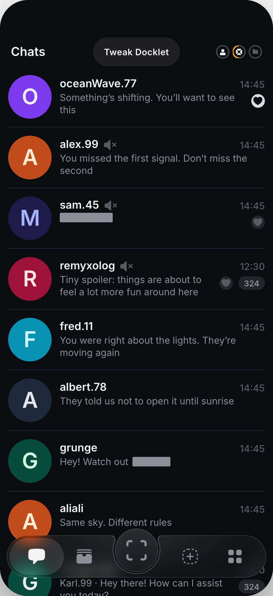
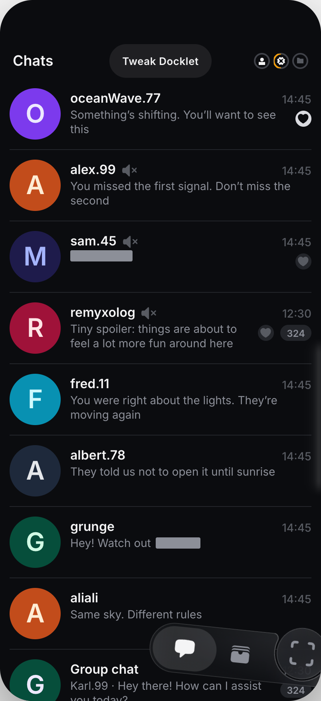
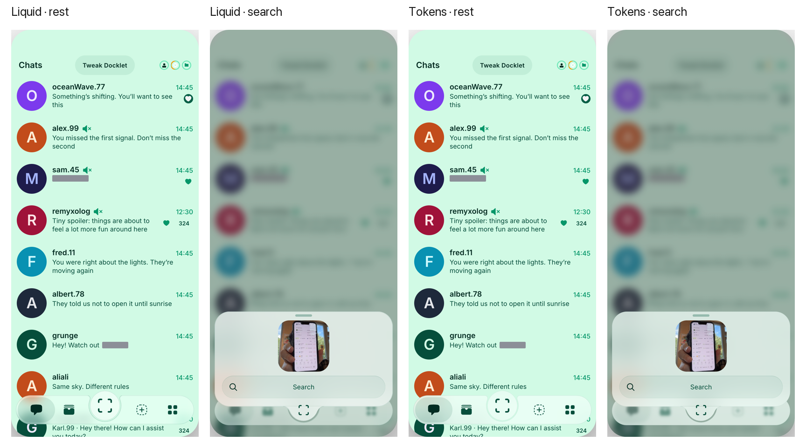

# Docklet R3 brief

> **A living document.** The Docklet goes through periodic reviews, and this page is updated and extended after each of them.

> **R3: the fuller Docklet, after R2.** It adds the expanded view with every product, the pin slot, the right slot as an app switcher and the product menu. What ships in R2 (the R1 Docklet, hiding, and products' bottom controls riding above it) is in the [R2 brief](https://github.com/SabitKadyr/docklet-playground-src/blob/main/docs/docklet-r2/Docklet%20R2%20brief.md).

The Docklet is a floating bar at the bottom of the screen. It holds the app's two main tabs, opens search, gives a way to every product, and gets out of the way when you don't need it. This page describes how it behaves in the prototype as of **Docklet Liquid v0.2.23** ([APK](https://github.com/SabitKadyr/docklet-playground-src/releases)). Sizes, colours, fonts and motion for developers are in the R1 brief.

## What's on it

| Part | What it is | Tap |
| --- | --- | --- |
| **Chats**, **Pocket** | The app's two main tabs | Goes there |
| **Pill** (centre) | Search and scan | Opens search |
| **Pin slot** | One product you choose to keep on the Docklet | Opens it; empty, it offers to pin one |
| **Right slot** | The product you are in, or the last one you used | Goes back to it; empty, it is an **Apps** button that shows every product |

A highlight always sits on where you are. A tap on the highlighted icon opens its menu.

## Gestures at a glance

| Where | Gesture | Result |
| --- | --- | --- |
| Pill | Tap | Search opens: scan and a search field |
| Pill | Swipe up | Search opens straight to typing |
| Docklet | Swipe up | The expanded view: every product |
| Docklet | Swipe right | The Docklet hides into the right edge |
| Highlighted icon | Tap | Its menu |
| A product in the expanded view | Press and hold | The product's menu |
| Right edge, Docklet hidden | Drag in, tap the glow, or Back | The Docklet comes back |
| Anywhere outside the Docklet | Tap | The Docklet hides on its own |

A swipe steeper than 30° counts as up; a near-horizontal swipe to the right hides the Docklet. Left and down on the Docklet do nothing.

## Products

> **The products in the prototype are placeholders.** Calc, Coin, Dice, Timer and the rest are only there to test how the Docklet works with products. Ignore what they do and how they look.

### Opening a product

<table><tr>
<td> Swipe up: every product</td>
<td> The open product sits in the right slot</td>
<td> The first time: a tip about the swipe up</td>
</tr></table>

A product opens from three places:

- **The expanded view.** Swipe up on the Docklet (anywhere but the Pill) and it grows into a grid of every product. Tap one to open it: the grid folds away, the product takes the screen, and the Docklet tucks itself away at once.
- **The pin slot**, for the one product you pinned.
- **The right slot**, which brings back the product you were last in.

The grid lists favourites first, top left, with a thin line between them and the rest. Products already on the Docklet (pinned, or in the right slot) are left out of the grid, so nothing shows twice.

The right slot starts as an **Apps** button that opens the expanded view; nothing fills it on its own. The first time a product takes its place, the swipe up becomes the only way to every product, so a tip says "Swipe up on the dock to see all your apps" and the expanded view peeks up a little and springs back to show the gesture.

### While a product is open

<table><tr>
<td> A product open: it stays in the right slot</td>
<td> Tap the highlighted product: its menu</td>
</tr></table>

- **It sits in the right slot, highlighted.** A pinned product is highlighted in the pin slot instead.
- **Leaving is not closing.** Tap Chats or Pocket and the product stays in the right slot; a tap on it takes you back where you left it.
- **One product at a time in the right slot.** Opening another product puts it there and closes the one before. The pinned product keeps its own slot alongside.
- **The Docklet works as anywhere else:** search, the expanded view, hiding and auto-hide all work on top of the product.

### The product's menu

Tap the highlighted product on the Docklet, or press and hold a product in the expanded view.

The menu changes with what each product can do: a product can add its own items or leave some out. The items below are the basic set the prototype starts from; treat them as placeholders too.

| Item | Shown | What it does |
| --- | --- | --- |
| **Pin to the dock** / **Unpin from the dock** | always | Pin moves it to the pin slot and out of the right slot and favourites. Unpin empties the pin slot; if the product is on screen, it moves to the right slot |
| **Add to favourites** / **Remove from favourites** | always | Moves it to or from the top of the grid |
| **Refresh** | while it runs | Restarts it ("… restarted") |
| **Close** | while it runs, unless pinned | Ends it and empties the right slot. If it was on screen, you land on Chats |

A product can also be pinned from the empty pin slot: tap it, choose **Choose an app to pin**, and the product you then tap in the grid is pinned and opens.

### Products with their own bottom bar

As in R2: a product's bottom controls ride just above the Docklet while it is shown and come down when it hides. The details are in the R2 brief.

## Search from the Pill

<table><tr>
<td> At rest: the Pill shows the scan icon</td>
<td> Tap: scan preview and search field</td>
<td> Field or swipe up: typing</td>
</tr></table>

- **One shape.** The search card grows out of the Pill as one piece of glass; the Pill becomes the bump at the card's bottom.
- **Two steps.** A tap opens the camera to scan and a search field. A tap on the field moves on to typing, with recent contacts above the keyboard. A swipe up on the Pill skips straight to typing.
- **The scan icon stays.** It never turns into a ✕: it shrinks and rides down into the bump, where a tap on it closes the card.
- **Closing:** the icon in the bump, a swipe down on the card, a tap outside it, or Back.

## Hiding the Docklet

### Drawbridge: swipe it away

<table><tr>
<td> Swipe right: the Docklet follows the finger</td>
<td> Hidden: a faint glow at the right edge</td>
<td> Drag it back in from the glow</td>
</tr></table>

- **Swipe right** anywhere on the Docklet and it swings up and out into the right edge, like a drawbridge. The closer to the edge you start, the shorter the swipe needed.
- **It stays under your finger**, also if you swipe right and then down, and runs a little ahead towards the edge so you feel where it is going.
- **It can't be dragged all over the screen.** The bottom of the screen is a floor; lifting it, or pulling it away from the edge, meets a resistance that grows the further you go.
- **Let go** past halfway, or with a quick flick, and it hides; otherwise it settles back.
- **Hidden**, a soft glow marks the edge. It brightens and shimmers when you touch it.
- **Bringing it back:** drag it in from the glow, tap the glow, swipe Back from that edge below the glow, or press Back. A Back swipe from the other edge is a plain Back and leaves it hidden.
- On Android, the system Back gesture is off where the Docklet is (and over the glow while it is hidden), so these swipes reach the Docklet.

### Auto-hide

 The first time it hides on its own, it says so

- The Docklet hides as soon as you tap outside it, and after **3 seconds** without a touch.
- It stays while something on it is open: search, the expanded view, a menu or a tip.
- The first time it hides on its own, a tip says "Your dock is tucked away" and how to get it back.

## Look: themes and glass

- **The app's five themes:** Berlin Night (the default), Berlin Day, Tokyo, Malta and Lisbon. Every colour of the Docklet comes from the app's design tokens, so a theme changes only their values. A theme switch applies at once.
- **One outline** runs round the Docklet, the Pill, the expanded view and the search card: on the light themes slightly darker than the glass, in the theme's own hue. There is no shadow.
- **Glass:** iOS 26 and later use the system Liquid Glass; below iOS 26 and on Android the glass is the theme's surface colour over a blur. The prototype shows both.

## Open questions

- **Products or apps in the interface.** This page says products, but the Docklet still says **Apps** (the right slot's button) and "see all your apps" (the tip). Which word ships is still to be decided.
- **The pin slot and the right slot when the expanded view opens.** One proposal is that their icons move into their regular places in the grid instead of staying in the slots. Not taken on yet: the purpose and a logical way to do it are still being worked out.
- **Settings and Connection status.** R2 puts them on the right side of the Docklet (still to be decided); how they sit next to the pin slot and the right slot in R3 is open.

## For testers: the prototype's Tweak panel

The **Tweak Docklet** button at the top of the prototype holds settings to compare options:

| Tweak | Setting | Options (default first) |
| --- | --- | --- |
| Hide gesture | Edge cue | Pull · Pivot · Lean · Free · Off |
| Hide gesture | Auto-hide | on/off, "Hide after tapping elsewhere" (0 s), "Hide when idle" (3 s) |
| Tabs | Right slot | Hotseat · Always menu · Keep last app |
| Centre button | Icon | Scan · Plus · Search |
| Material | Theme | Night · Day · Tokyo · Malta · Lisbon (tapping Theme in the prototype's Settings cycles them too) |
| Material | Glass | Liquid · Tokens |
