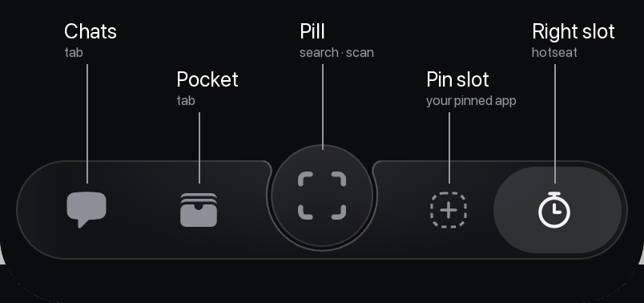
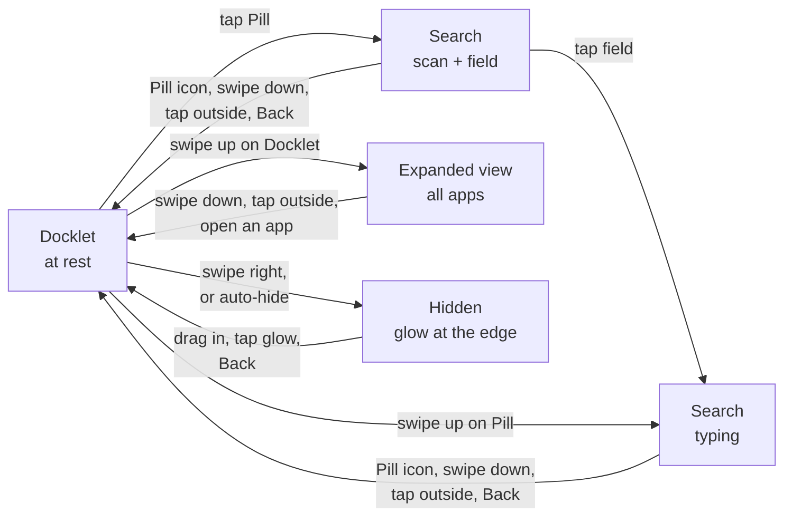
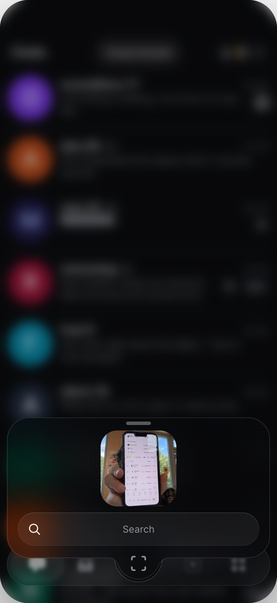
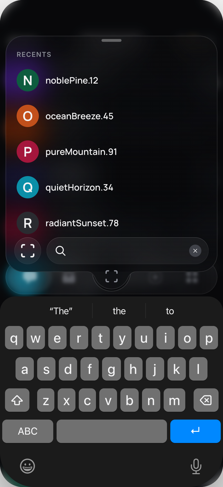
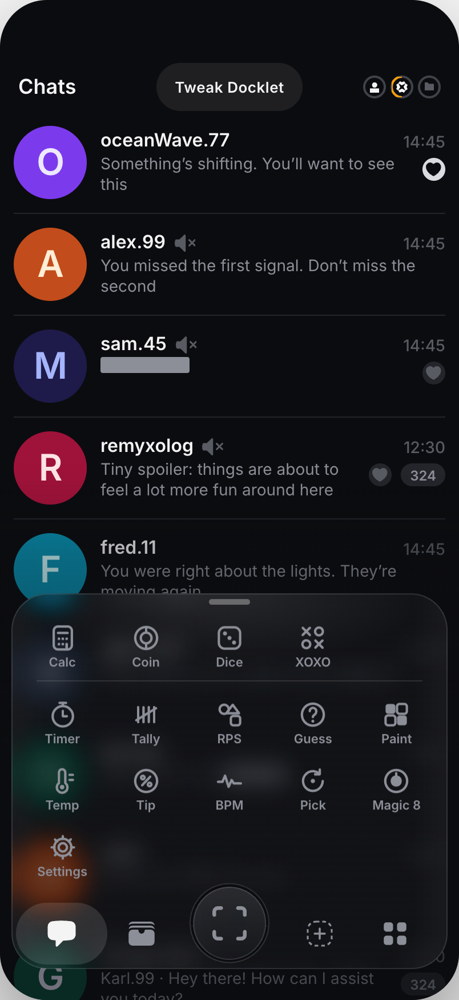
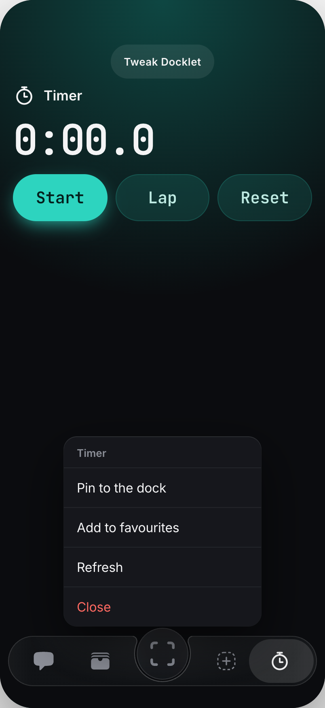
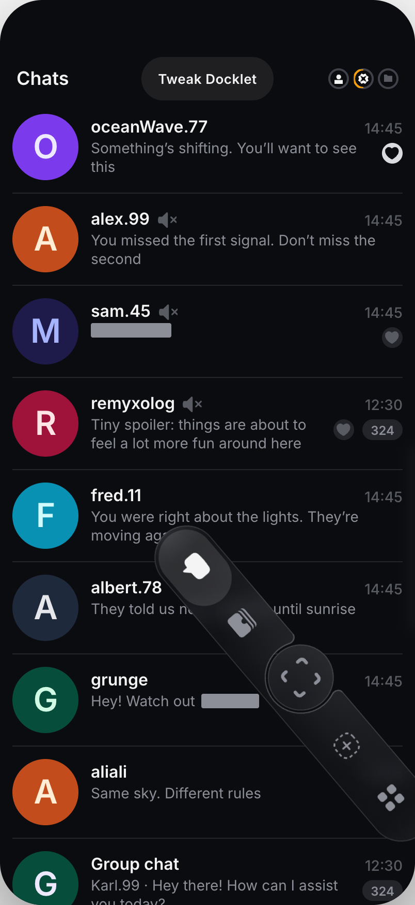
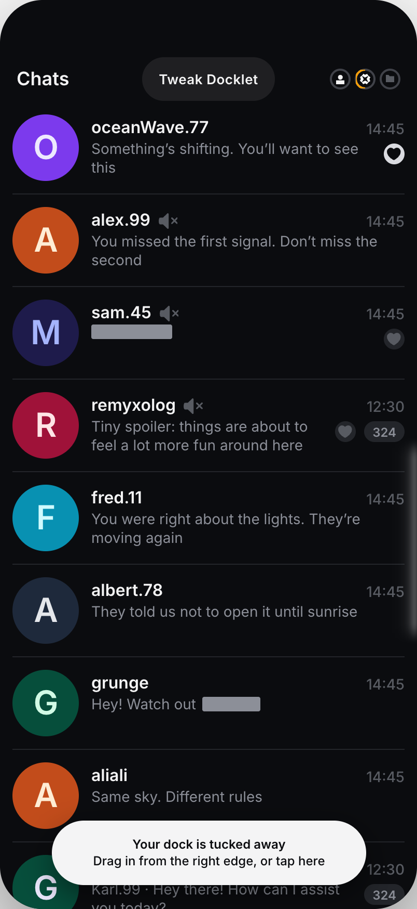
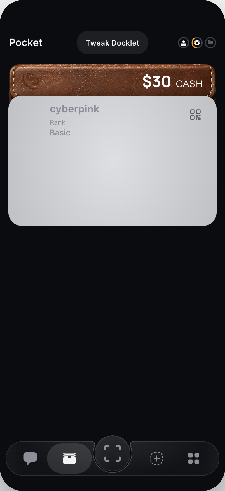

# The Docklet: how it works

> **A living document.** The Docklet goes through periodic reviews, and this page is updated and extended after each of them.

The Docklet is a floating dock at the bottom of the screen. It holds the app's main places, opens search, gives a way to every app, and gets out of the way when you don't need it. This page describes how it behaves in the prototype as of **Docklet Liquid v0.2.23** ([APK](https://github.com/SabitKadyr/docklet-playground-src/releases)).

## What's on it

| Part | What it is | Tap |
| --- | --- | --- |
| **Chats**, **Pocket** | The two main places of the app | Goes there |
| **Pill** (centre) | Search and scan | Opens search |
| **Pin slot** | One app you choose to keep here | Opens that app; empty, it offers to pin one |
| **Right slot (hotseat)** | The app you are in, or the last one you used | Goes back to it; empty, it is an **Apps** button |

The highlight always sits on the place you are in. A tap on the already highlighted icon opens that place's menu.

## Gestures at a glance

| Where | Gesture | Result |
| --- | --- | --- |
| Pill | Tap | Search opens (scan + search field) |
| Pill | Swipe up | Search opens straight to typing, keyboard up |
| Docklet | Swipe up | Expanded view: all apps |
| Docklet | Swipe right | The Docklet hides into the right edge (Drawbridge) |
| Highlighted icon | Tap | That place's menu |
| An app in the expanded view | Press and hold | That app's menu |
| Right edge, Docklet hidden | Drag in, tap the glow, or Back | The Docklet comes back |
| Anywhere outside the Docklet | Tap | The Docklet hides on its own (auto-hide) |

Up and right are told apart by the swipe's angle: steeper than 30° up is "up", near-horizontal to the right is "hide". Left and down on the Docklet do nothing.

## Search from the Pill

<table><tr>
<td> At rest: the Pill shows the scan icon</td>
<td> Tap: scan preview and search field</td>
<td> Field or swipe up: typing with the keyboard</td>
</tr></table>

- **One shape.** The search card grows out of the Pill as one piece of glass; the Pill becomes the bump at the card's bottom.
- **Two steps.** A tap opens the first step: the camera to scan and a search field. A tap on the field moves on to typing, with recent contacts above the keyboard. A swipe up on the Pill skips straight to typing.
- **The Pill's icon stays the scan icon.** It never turns into a ✕: when the card opens it just gets smaller and rides down into the bump, where a tap on it closes the card.
- **Closing:** the icon in the bump, a swipe down on the card, a tap outside it, or Back.
- **Text in the card uses the design system's type tokens:** the "Search" placeholder is bodyMedium, the typed query bodyLarge, RECENTS / RESULTS captionMedium, contact names titleMedium (as in the app's own contact row) and the avatar letter headlineSmall.

## The expanded view: every app

<table><tr>
<td> Swipe up on the Docklet</td>
<td> With an app open: it stays in the right slot</td>
</tr></table>

- **Swipe up** anywhere on the Docklet (except the Pill) and it grows into a grid of every app. Swipe down, tap outside or open an app to close it.
- **Favourites first.** The apps you marked as favourites sit at the top left; a thin line separates them from the rest. There are no hearts: the position says it.
- **Nothing shows twice.** The pinned app and the app in the right slot stay in their slots and are left out of the grid.
- **Press and hold an app** for its menu: pin it to the Docklet, add it to or remove it from favourites, refresh it, or close it.

## The right slot: the hotseat

<table><tr>
<td> The open app sits in the right slot</td>
<td> First time: a tip about the swipe up</td>
<td> Tap the highlighted icon: its menu</td>
</tr></table>

- The right slot holds the app you are in, or the last one you used (unless it is pinned). A tap takes you back to it; when it is the highlighted one, a tap opens its menu.
- With no app there (first start, or after you pin that app) it is an **Apps** button that opens the expanded view. Nothing is filled in on its own.
- **A one-time tip.** The first time the Apps button gives way to an app, the only way left to all apps is the swipe up. So at that moment a tip says "Swipe up on the dock to see all your apps", and the expanded view peeks up a little and springs back to show the gesture. The Docklet doesn't auto-hide while the tip is up.

## Hiding the Docklet: Drawbridge

<table><tr>
<td> Swipe right: the Docklet follows the finger</td>
<td> Hidden: a faint glow at the right edge</td>
<td> Drag it back in from the glow</td>
</tr></table>

- **Swipe right** from anywhere on the Docklet and it swings up and out into the right edge, like a drawbridge. The swipe needed gets shorter the closer to the edge you start.
- **Your finger stays on it.** While you drag, the Docklet follows your finger, also if you swipe right and then down; held, it turns about your finger, and the full turn finishes after you let go. To keep the finger on it the Docklet gets some freedom while held, but it is bounded: the bottom of the screen is a floor, and lifting it or pulling it the wrong way meets a soft resistance that grows the further you go.
- **It leans towards the edge.** The further you drag, the more it runs ahead of your finger towards the edge, so you can feel where it is going (Tweak → Hide gesture → Edge cue → Pull, the default).
- **Let go** past halfway, or with a quick flick, and it hides; otherwise it settles back.
- **Hidden,** a soft glow marks the edge where it went. It brightens and shimmers when you touch it.
- **Bringing it back:** drag it in from the glow, tap the glow, or swipe Back from that edge below the glow (the Docklet follows the Back swipe). The Back key brings it back too. A Back swipe from the other edge is a plain Back and leaves it hidden.
- On Android, the system Back gesture is switched off where the Docklet is, and over the glow while it is hidden, so these swipes reach the Docklet instead of the system.

## Auto-hide

 The first time it hides on its own, it says so

- The Docklet hides as soon as you tap somewhere outside it, and after **3 seconds** without any touch.
- It doesn't hide while something on it is open: search, the expanded view, a menu or a tip.
- The first time it hides on its own, a tip says "Your dock is tucked away" and how to get it back.

## Pocket

 The Cash wallet

The Cash card in Pocket is a leather wallet that catches the light as you tilt the phone. A tap opens it as a Purse with Get and Send; the close button, a tap on the wallet or Back closes it.

## Themes and glass

- **Five themes, the app's own:** Berlin Night (the default), Berlin Day, Tokyo, Malta and Lisbon. The Docklet and every screen behind it take their colours from the design tokens of the Polkadot app, so a theme changes only the values, never which token is used where. A theme switch applies at once, with no colour fade.
- **One outline for all the glass:** the dock, the Pill, the expanded view and the search card share a 1 pt outline in the token **stroke/glass** (the theme's inverted container colour at 12 %). On the light themes it reads as an edge about 10 % darker than the glass, in the theme's hue; on Berlin Night as a faint light line.
- **No shadow** under the Docklet in any theme.
- **Two kinds of glass** to compare (Tweak → Material → Glass):
  - **Liquid**, the default: the prototype's own glass, standing in for iOS 26 Liquid Glass. On the light themes it is frosted with white, without the grey tint it has on Berlin Night.
  - **Tokens**: what the app draws below iOS 26 and on Android, the theme's container colour at 70 % over a blur.

## Where to try other behaviours

The **Tweak Docklet** button at the top of the prototype holds the settings used to compare options. The ones that change the behaviour above:

| Tweak | Setting | Options (default first) |
| --- | --- | --- |
| Hide gesture | Edge cue | Pull · Pivot · Lean · Free · Off |
| Hide gesture | Auto-hide | on/off, "Hide after tapping elsewhere" (0 s), "Hide when idle" (3 s) |
| Tabs | Right slot | Hotseat · Always menu · Keep last app |
| Centre button | Icon | Scan · Plus · Search |
| Material | Theme | Night · Day · Tokyo · Malta · Lisbon (also: tap Theme in the prototype's Settings to cycle) |
| Material | Glass | Liquid · Tokens |

## Still open

- **Icons in the pin slot and the right slot when the expanded view opens.** One proposal is that they move into their regular places in the grid instead of staying in their slots. Not taken on yet: the purpose and a logical way to do it are still being worked out.
